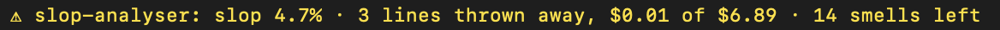

# slop-analyser

Reads Claude Code transcripts to report session cost, code churn, and the spend behind lines thrown away.

[](https://www.npmjs.com/package/slop-analyser)
[](https://github.com/tttmaximttt/slop-analyser/actions/workflows/ci.yml)
[](LICENSE)


## Quickstart

In a project you have used Claude Code in:

```sh
npx -p slop-analyser slop-report --latest
```

It runs locally, reads `~/.claude/projects/<project>/<session>.jsonl` and makes no API calls. To get it as a Claude Code plugin with a status line and cleanup agents, see [Install](#install).

## Real results

Measured on 2026-11-03 with slop-report 0.3.7 over the author's own Claude Code history: 29 sessions in 8 projects (14 of them wrote code), 2026-10-06 to 2026-11-03, one `slop-report --json` run per session, summed.

| Measure | Value |
| --- | --- |
| Total spend | $864.04 |
| Spend on messages that wrote code | $21.40 |
| Lines written / surviving | 15,078 / 14,805 |
| Rewritten after a failure (rework) | 85 lines (0.6%) |
| Rewritten with no failure (slop) | 188 lines (1.2%), $1.23 wasted |
| Top smells in surviving code | duplicated 4-line block 35, debug output 17, `any` 8, lint/type suppression 2, TODO 2 |
| Comments added to source (informational) | 861 |

Most spend goes to messages that read, plan and re-read cached context: only $27.03 was in sessions that wrote no code. Wasted cost counts only the message that wrote a discarded line, so it is a floor. One person's sessions, and edits made through Bash are not counted, so churn is a lower bound too; see [Limits](#limits).

## What's in it



- `slop-report` reports a session's cost, lines written, lines rewritten, and static smells in what remains. It costs no tokens.
- `slop-cleaner` is a Claude Code subagent based on the oh-my-claudecode `ai-slop-cleaner` workflow: measure, lock behaviour, plan, one smell per pass, gates, fixed report.
- `slop-reviewer` is a read-only subagent that reviews a cleaner pass and returns a verdict, keeping writer and reviewer separate.

## Install

In Claude Code:

```
/plugin install slop-analyser --marketplace tttmaximttt/slop-analyser
```

On versions before 2.1.275, add the marketplace first:

```
/plugin marketplace add tttmaximttt/slop-analyser
/plugin install slop-analyser@slop-analyser
```

That gives you:

| Component | Use |
| --- | --- |
| `/slop-analyser:slop-report` | Prints the report for the current session |
| `/slop-analyser:update` | Updates the plugin to the latest version; restart Claude Code to apply it |
| `slop-analyser:slop-cleaner` agent | Cleans up the session's code |
| `slop-analyser:slop-reviewer` agent | Reviews a cleanup without editing |
| `slop-report` command | On the Bash tool's PATH while the plugin is enabled |
| Status line entry | At session start and after each turn, `slop 3.2% · 12 lines thrown away, $0.41 of $2.10 · 5 smells left` for the current session: what was rewritten with no failure, and the smells still in the lines that survived (`slop — · $0.78 spent, no code written yet` until it writes code) |

Requires Node 20.10 or later. No dependencies.

### Or with npm

The package is [slop-analyser on npm](https://www.npmjs.com/package/slop-analyser).

```sh
npm install -g slop-analyser
slop-analyser setup
```

`setup` registers the installed package with Claude Code as a plugin marketplace and installs the plugin from it. To update, run `npm update -g slop-analyser` and then `slop-analyser setup` again; `/slop-analyser:update` only rereads the installed copy. `slop-analyser remove` undoes it. Nothing runs on `npm install` itself, so `--ignore-scripts` makes no difference.

The npm install also puts `slop-report` on your PATH, so you can run the report in a terminal or CI without Claude Code. Without installing anything:

```sh
npx -p slop-analyser slop-report --latest
```

## slop-report

```sh
slop-report --latest                      # newest session for the current directory
slop-report --latest --project ~/code/api # newest session for another project
slop-report --session <id>                # a specific session for the current directory
slop-report path/to/session.jsonl --json  # full report as JSON
```

Subagent transcripts in `<session>/subagents/*.jsonl` are included unless you pass `--no-subagents`.

What it counts:

| Measure | How |
| --- | --- |
| Cost | Each API response's usage (input, 5m and 1h cache writes, cache reads, output, fast mode) priced from `pricing.json`. A response split across several transcript lines is counted once. |
| Lines written | `+` lines from Edit, MultiEdit and Write. Blank lines and bare punctuation are ignored. |
| Rework | A line the session wrote, then removed after a tool failure (a failing command or test) in the same prompt's turn. This is normal iteration. |
| Slop | A line the session wrote, then removed with no failure prompting it. |
| Wasted cost | Each response's full cost is spread evenly over the lines it wrote; the share belonging to slop lines is wasted. |
| Smells | On surviving lines in code files: `any`, lint and type suppressions, debug output, TODOs, swallowed errors, duplicated 4-line blocks. Comments added to source are listed separately as informational and left out of the status line's count. |

### Limits

- The transcript format is not documented and can change between Claude Code releases.
- Edits made through Bash (`sed`, heredocs, `git checkout`, formatters, code generators) are not in the transcript as edits, so churn is undercounted.
- Removed lines are matched to earlier writes by text within the same file, so identical lines can be attributed to the wrong write.
- Per-line cost is an even split of a response's cost over the lines it wrote; one response that writes several files shares its cost among all of them.
- Prices in `pricing.json` are Anthropic first-party API rates as of October 2026. Verify them before relying on the dollar figures, and add any model the report lists as unpriced.

## Agents

Mention them with `@`, or ask for them by name:

```
@agent-slop-analyser:slop-cleaner session
@agent-slop-analyser:slop-cleaner src/orders/service.ts src/orders/mapper.ts
@agent-slop-analyser:slop-cleaner session approved: src/auth/session.ts
@agent-slop-analyser:slop-reviewer review the last slop-cleaner pass
```

`slop-cleaner` runs `slop-report` first to pick files and smells, locks behaviour with the narrowest tests, then cleans one bucket at a time (dead code, duplication, needless abstraction and boundary fixes, noise, tests), rerunning the lock after each. Each pass is judged against the failures and errors that were already there, test by test and error by error, so an unrelated failing test does not block it and an existing lint error cannot hide a new one. It does not edit sensitive code (authentication, payments, migrations, external API contracts, security) unless you name the file after `approved:`; it skips those changes and lists them for you to decide. It ends with five sections: changed files, simplifications, behaviour lock and verification, needs approval, remaining risks.

If you also run oh-my-claudecode, these agents do not replace its `ai-slop-cleaner` skill and do not collide with it: OMC blocks the `ai-slop-cleaner` subagent type, and these use different names. Avoid the words "deslop" and "anti-slop" in a prompt that should reach these agents, since OMC's keyword hook routes those to its own skill.
